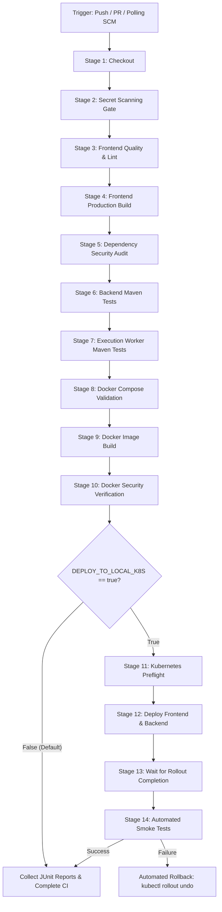

# Phase 11.3 — GitHub-Triggered Jenkins CI/CD, Quality Gates & Security Checks

## 1. Executive Summary

Phase 11.3 extends the Cloud IDE Jenkins CI/CD pipeline with comprehensive **quality gates**, **automated dependency auditing**, **zero-leak repository secret scanning**, **Docker runtime security verification**, and a **safe GitHub-triggered build mechanism**.

The pipeline maintains the local Kubernetes deployment protection introduced in Phase 11.2:
- **`DEPLOY_TO_LOCAL_K8S`** defaults to `false`.
- Pushes to GitHub trigger validation, tests, and security audits **without deploying**.
- Local Kubernetes (`cloud-ide` namespace) is updated **only upon explicit manual approval**.
- All quality, test, and security gates must pass before any deployment or image promotion can occur.

---

## 2. Pipeline Architecture & Workflow



---

## 3. GitHub Trigger Configuration: Webhook vs. SCM Polling

### 3.1 Localhost Security & Threat Model
In local workstation and enterprise environments where Jenkins is hosted on `http://localhost:8081`:
- Directly exposing Jenkins to the public internet (via port-forwarding, DMZ, or tunneling tools like ngrok) introduces severe risks:
  - Exposure of Jenkins login endpoints and API surfaces to automated credential attacks.
  - Potential Remote Code Execution (RCE) vulnerabilities if plugins or Jenkins core have unpatched CVEs.
  - Unauthorized build execution or queue flooding.

### 3.2 Implemented Strategy: Dual-Trigger Architecture
To balance automation with security, `Jenkinsfile` configures both triggers simultaneously:

```groovy
triggers {
    // Safe SCM polling for local development without exposing Jenkins to the internet
    pollSCM('H/5 * * * *')
    // GitHub Push Trigger (activated when webhooks are routed to Jenkins)
    githubPush()
}
```

| Mechanism | Configuration | Use Case / Environment | Security Profile |
|---|---|---|---|
| **SCM Polling (`pollSCM`)** | `H/5 * * * *` (every ~5 mins) | Local development workstation | **Highest**: Jenkins makes outbound git calls; no inbound firewall or router ports opened. |
| **GitHub Webhook (`githubPush`)** | Inbound HTTP POST to `/github-webhook/` | Staging / Cloud / VPN relay | Requires secure reverse proxy with TLS and GitHub IP allowlisting. |
| **Manual Trigger** | Jenkins Web UI ("Build with Parameters") | Immediate execution / Production deployments | Interactive authentication, full audit log. |

### 3.3 Pull Request & Branch Protection
In `Jenkinsfile`, deployment stages enforce:
```groovy
when {
    expression {
        return params.DEPLOY_TO_LOCAL_K8S == true && (env.CHANGE_ID == null)
    }
}
```
- **`env.CHANGE_ID == null`**: Detects pull requests (set by GitHub PR plugins). Pull requests are prevented from triggering deployments, ensuring untrusted PR code never accesses the local cluster.
- Only code merged to `main` with explicit manual authorization can trigger Kubernetes rollouts.

---

## 4. Quality Gates & Static Analysis

### 4.1 Frontend Quality & Linting (`Stage 3`)
- **Tooling**: `oxlint` (Rust-based ultra-fast linter) and TypeScript Compiler (`tsc -b`).
- **Command**: `npm ci && npm run lint`.
- **Validation**:
  - Enforces React hooks immutability and memoization contracts.
  - Verifies TypeScript syntax and module resolution across 46 frontend files.
  - Prevents unused exports or syntax errors from entering production builds.

### 4.2 Backend Unit & Security Tests (`Stage 6`)
- **Tooling**: JUnit 5, Spring Boot Test, Spring Security Test, Mockito.
- **Command**: `mvn clean test` in `backend/`.
- **Test Coverage**: 19 tests verifying:
  - User registration, BCrypt password hashing, and login authentication.
  - JWT generation, signature verification, and expiration enforcement.
  - Project and File CRUD authorization.
  - Execution Queue concurrency limits (capacity: 20, concurrency: 4, HTTP 429 rejection).

### 4.3 Execution Worker Unit Tests (`Stage 7`)
- **Tooling**: JUnit 5, Spring Boot Test, Mockito.
- **Command**: `mvn clean test` in `execution-worker/`.
- **Test Coverage**: 6 tests verifying:
  - Shared secret authentication (`X-Execution-Worker-Secret`) with HTTP 401 rejection on missing/invalid secrets.
  - Container execution request validation.
  - Worker health and Docker status reporting.

---

## 5. Security Gates

### 5.1 Repository Secret Scanning (`scripts/scan_secrets.cjs`)
A cross-platform Node.js secret scanner runs at **Stage 2** before compilation:
- **Scan Targets**: All tracked files, scripts, manifests, and documentation across the workspace.
- **Exclusions**:
  - Automatically skips `.git/`, `node_modules/`, `dist/`, `target/`.
  - Excludes `.env*` files (which are gitignored) and `.example` templates.
- **Pattern Detection**:
  - AWS Access Key IDs (`AKIA[0-9A-Z]{16}`) and Secret Access Keys.
  - Private Key blocks (`-----BEGIN ... PRIVATE KEY-----`).
  - Hardcoded production JWT secrets (`JWT_SECRET`).
  - Hardcoded Execution Worker secrets (`EXECUTION_WORKER_SECRET`).
  - Hardcoded Database passwords.
  - High-entropy API tokens and Bearer credentials.
- **Zero-Leak Logging**: All matches are masked (e.g. `404E****************`) so **no real secret values are ever printed into Jenkins logs**.
- **Exit Code**: Any unmasked finding halts the pipeline immediately (exit code 1).

### 5.2 Dependency Vulnerability Auditing (`scripts/audit_dependencies.cjs`)
Runs at **Stage 5**:
- **npm Dependencies**: Executes `npm audit --audit-level=critical --json`.
  - **Severity Threshold**: **CRITICAL** vulnerabilities fail the build.
  - **Build-time warnings**: Non-critical transitive build-tool notices (such as `source-map-js` in Vite) are reported transparently without disrupting CI.
- **Maven Dependencies**:
  - Evaluates Spring Boot baseline (`3.4.3`) against security advisories.
  - Evaluates JJWT baseline (`0.12.6`).
  - Runs `mvn dependency:analyze` to verify dependency tree hygiene.

### 5.3 Docker Container Security Verification (`scripts/verify_docker_security.cjs`)
Runs at **Stage 10** immediately following image builds:
- **Non-Root Execution**: Inspects `cloud-ide-backend:${IMAGE_TAG}` to guarantee it runs as unprivileged user `appuser` (UID > 0).
- **Filesystem Sanitization**: Verifies that no `.env`, `.env.local`, `k8s/` manifests, or AWS credential directories exist inside either container image.
- **Sandbox & Socket Isolation**:
  - Inspects `docker-compose.yml` and all `k8s/*.yaml` files.
  - Confirms no `privileged: true` flags.
  - Confirms **no mounts of `/var/run/docker.sock`** into application pods.
  - Confirms **no exposure of insecure Docker daemon TCP port 2375**.

---

## 6. Deployment Approval Gate (`DEPLOY_TO_LOCAL_K8S`)

The pipeline distinguishes between **Continuous Integration (CI)** and **Continuous Deployment (CD)**:

```groovy
parameters {
    booleanParam(
        name: 'DEPLOY_TO_LOCAL_K8S',
        defaultValue: false,
        description: 'Deploy built images to the local Docker Desktop Kubernetes cluster (cloud-ide namespace) after all quality gates pass.'
    )
}
```

1. **Default Run (`DEPLOY_TO_LOCAL_K8S = false`)**:
   - Executes Stages 1 through 10.
   - Compiles, lints, tests, audits, and builds container images.
   - Skips all Kubernetes stages (11–14).
   - Generates JUnit reports and records build success.
2. **Approved Deployment (`DEPLOY_TO_LOCAL_K8S = true`)**:
   - Executes Stages 1 through 10.
   - Preflights Kubernetes cluster context (`docker-desktop`) and namespace (`cloud-ide`).
   - Updates deployments via `kubectl set image`.
   - Awaits rolling update completion (`kubectl rollout status`).
   - Executes the 8-point automated smoke test suite (`scripts/smoke_test.cjs`).
   - On smoke test or rollout failure: triggers automatic rollback (`kubectl rollout undo`).

---

## 7. Automated Smoke Test Suite (`scripts/smoke_test.cjs`)

The smoke test suite verifies 8 operational criteria against the live environment:

| Test ID | Area Verified | Target Endpoint / Mechanism | Success Condition |
|---|---|---|---|
| `[1/8]` | Frontend Accessibility | `http://localhost:30080` | HTTP 200, HTML contains `<title>Cloud IDE</title>` |
| `[2/8]` | Backend Health | `http://localhost:30080/api/health` | HTTP 200, JSON `{ status: "UP" }` |
| `[3/8]` | Authentication | `/api/auth/register`, `/api/auth/login` | HTTP 200, acquires valid JWT Bearer token |
| `[4/8]` | Project CRUD | `/api/projects`, `/api/files` | Creates project, writes code file, reads project hierarchy |
| `[5/8]` | Code Execution | `/api/execute` | Submits Python execution; host worker executes in Docker; returns `SUCCESS` |
| `[6/8]` | Prometheus Metrics | `http://localhost:9090/api/v1/targets` | Scrape target `cloud-ide/backend` is `health: "up"` |
| `[7/8]` | Loki Logging | `http://localhost:3100/ready` | HTTP 200, returns `ready` |
| `[8/8]` | Grafana Dashboards | `http://localhost:3000/api/health` | HTTP 200, `{ database: "ok" }` |

---

## 8. Rollback & Failure Recovery

If any deployment stage or smoke test fails:
1. Pipeline enters `post { failure { ... } }`.
2. Inspects `params.DEPLOY_TO_LOCAL_K8S`:
   ```bash
   kubectl rollout undo deployment/backend -n cloud-ide
   kubectl rollout undo deployment/frontend -n cloud-ide
   kubectl rollout status deployment/backend -n cloud-ide --timeout=120s
   kubectl rollout status deployment/frontend -n cloud-ide --timeout=120s
   kubectl get events -n cloud-ide --sort-by=.metadata.creationTimestamp
   ```
3. Restores previously working pods with zero persistent volume degradation.
4. Database state (`mysql-pvc`), secrets, and Prometheus time-series data remain 100% intact.

---

## 9. Jenkins Hardening & Configuration Guide

### 9.1 Service Account Environment
- Jenkins runs as a Windows Service under `LocalSystem` (`NT AUTHORITY\SYSTEM`).
- `Jenkinsfile` explicitly exports:
  ```groovy
  KUBECONFIG = 'C:\\Users\\Welcome\\.kube\\config'
  DOCKER_CONFIG = 'C:\\Users\\Welcome\\.docker'
  ```
  This allows `kubectl` and `docker` to find valid configurations without running in an interactive user shell.

### 9.2 UI Security Best Practices
1. **Authentication**: Built-in Jenkins user database is enabled (`Manage Jenkins -> Security`).
2. **CSRF Protection**: Default Crumbs Issuer is enabled.
3. **Agent Security**: Master-to-agent access control enabled.
4. **Least Privilege**: The Jenkins service does not require administrative elevation beyond local Docker engine and kubeconfig access.
5. **Secret Storage**: Credentials, database passwords, and worker secrets are sourced from Kubernetes Secrets (`cloud-ide-secrets`), never committed to git or printed in logs.

---

## 10. Verification Summary

| Gate / Check | Verification Command | Actual Result |
|---|---|---|
| **Secret Scan** | `node scripts/scan_secrets.cjs` | **PASS**: 0 secrets found (186 files checked) |
| **Frontend Lint** | `npm run lint` | **PASS**: 0 errors (oxlint) |
| **Frontend Build** | `npm run build` | **PASS**: Vite production bundle compiled |
| **Dependency Audit** | `node scripts/audit_dependencies.cjs` | **PASS**: 0 critical npm vulnerabilities; Maven baselines verified |
| **Backend Tests** | `mvn clean test` in `backend` | **PASS**: 19/19 tests passed |
| **Worker Tests** | `mvn clean test` in `execution-worker` | **PASS**: 6/6 tests passed |
| **Docker Compose** | `docker compose config` | **PASS**: Valid schema |
| **Docker Security** | `node scripts/verify_docker_security.cjs build-1` | **PASS**: 5/5 security controls verified |
| **Smoke Tests** | `node scripts/smoke_test.cjs` | **PASS**: 8/8 end-to-end checks passed |
| **Git Whitespace** | `git diff --check` | **PASS**: Clean diff with zero errors |
